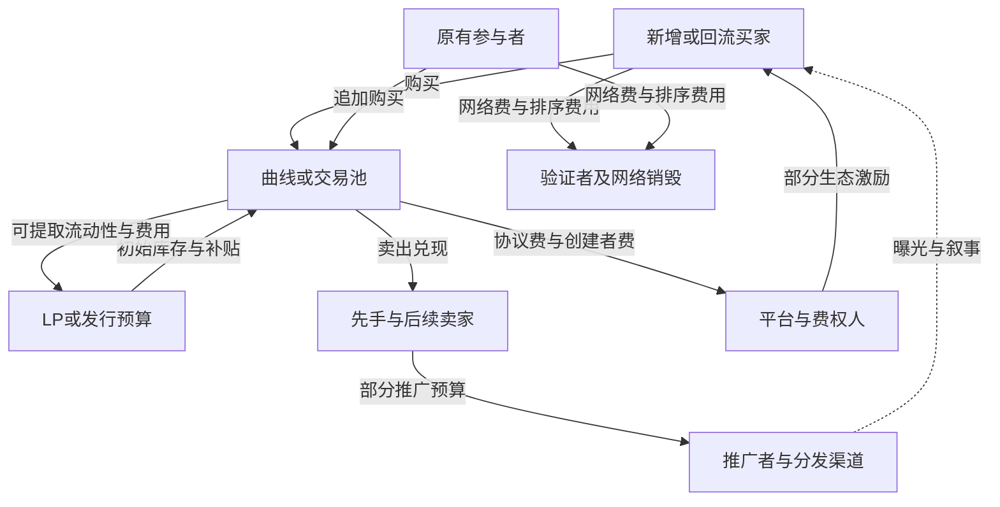

# 加密极端右尾研究：独立顶层方案

日期：2026-10-17（北京时间）。性质：研究设计，不是盈利结论、交易指令或资金投入建议。

本次项目输入仅为附件《背景(5).md》和《independent_global_maps_2026-10-12(1).md》。没有读取旧项目仓库、附带的审阅笔记或综合 CSV，没有运行回测、下载交易样本或发送交易。地图用于检查遗漏，不沿用其结论或来源编号。本文来源 S01—S34 为本次重新检索的外部资料，文末提供链接、适用范围和限制。

## 先给出判断

**最值得研究的位置，是“已有公开证据、仍存在认知分歧、普通速度能够进入、后来需求足以承接退出”的小市场。** 中文信息位置、时间和小资金只是形成优势的条件，目前都没有被证明能带来正收益。应让这些条件接受直接检验，而不是先认定优势存在，再围绕它搭系统。

项目的研究对象应是“一次有明确支付路径的机会”，具体包含：谁可能继续付款、我们凭什么比价格更早识别、取得哪一种权利、已有谁在低成本持有、普通速度能否进入、最后谁承接兑现。币是载体，钱包是观测对象，模型是研究工具。

**先建立三条相互竞争的研究线：语义与传播、库存与需求交接、场所与分配规则。** 首期同时深做最多两条，第三条只观察。每条线先做能否定关键前提的小检验，再决定是否值得获取更完整数据。不要直接启动全市场逐笔仓库、全角色分类器或自动交易系统。

### 目标与边界

| 项目 | 本方案采用的口径 |
|---|---|
| 最终目标 | 从首次实盘 T0 起三年内，任一时点累计净投资收益达到人民币 100 万元；不是账户总资产到 100 万元 |
| 收益核算 | 净清算价值＋累计提款－累计外部入金；净清算价值须扣可兑现成本、负债和应付税费 |
| 资金路径 | 首笔 1 万；一年内增至 10 万以上可按背景追加 2 万；首笔亏完可投入第二笔 1 万；累计净亏 2 万暂停，最后一笔须满足背景的模拟条件；累计净亏 3 万永久停止 |
| 本次范围 | 只研究可能产生极端右尾的加密市场；本次要求覆盖背景中此前放宽右尾范围的条目 |
| 当前动作 | 仅公开资料研究和设计；不开户、不入金、不签名、不发送交易、不执行付费查询 |
| 预算 | 按用户给定每期约 2,500 Dune credits 设计；这是研究预算，不是对现行套餐赠送额度的断言 |
| 现实能力 | 中文语义和信息位置、每周约 40 小时、小资金；不假设拥有低延迟、内部订单流或发行方关系 |
| 过程指标 | 数据完整、判断可复现、识别出结构差异均可算研究进展，但都不能冒充最终成功 |

一个需要先算清的算术事实：1 万元全部取得 100 倍净回收，利润是 99 万元，仍未达到 100 万元净利润。如果只有 1,000 元取得 100 倍净回收，这一笔贡献为 9.9 万元。这里的金额只说明账户与单币倍数的差别，不是仓位建议。因此，“找到百倍币”并没有回答“本账户能否达到目标”。

## 1. 市场机制：现金、库存、注意力和权利

### 1.1 钱从哪里来、到哪里去

以下是按经济角色归纳的现金机制图，不代表所有平台采用同一合同。实线表示资金或费用；虚线表示注意力。代币从卖方/池流向买方的反向交付未全部画出。

图的合同依据：Pump 明确区分协议费、创建者费和 LP 费；AMM 交易在两种资产储备间交换；Solana 网络费与排序小费另有归属。[S01][S02][S21][S33] 推广与市场操纵的付款关系见实证研究和已认罪案件。[S08][S09] 图中的“部分”表示可能存在的路径，不能据此认定某个具体项目做了这些支付。

| 现金来源/去向 | 要核查的经济含义 | 容易混淆的地方 | 依据 |
|---|---|---|---|
| 外部买家或回流资金购买 | 给卖方或池带来报价资产，如 SOL、稳定币 | 链内换币不自动等于全市场新增现金；新地址也不等于新资金 | [S06][S33]＋会计推断 |
| LP 或发行方注入初始资产 | 为早期交换提供库存，可能承担后续卖压 | 池中资产属于具体权利人；不是为买家准备的无条件赔付基金 | [S14][S33] |
| 先手、关联方及后续交易者卖出 | 从其他参与者或池的报价储备中兑现 | 高成本后手也可能盈利；早入场也不保证最终盈利 | [S03]，最后一句为推断 |
| 平台、创建者、渠道、网络收费 | 不需要持币上涨也可收款，但自身仍可能有成本 | 创建者费不是普通持币人的现金流；手续费回到池也不是立刻归买家所有 | [S01][S15][S21] |
| 财库补贴、空投、奖励 | 支付者可能是财库、赞助者，或承担稀释的持有人 | 发新币只是发资产；有人愿意用报价资产接手，才有兑现收入 | [S16]＋会计推断 |
| 产品或文化消费需求 | 用户可能为了使用、收藏、身份或投机而购买 | 有用户不等于需求必然落在某枚代币；有注意力也不等于有付款 | [S09][S19]＋待检验机制 |

**纯转售市场中的持币利润，需要由后来支付、已有池库存或其他持有者的损失承接。** 但不能把整个生态简单称为固定零和：外部资金、消费价值和补贴可以进入，网络费用等可以流出。账面总市值也不受现金守恒约束；少量成交可以重估全部未售库存。[S04][S33]

由此得到四个不同问题：市场能不能出现极端上涨；普通参与者能不能及时取得库存；大涨后能不能退出；这笔可兑现净收益能不能实质改变账户路径。只有第一问为真，远远不够。

### 1.2 参与者、足迹、伪装与识别

下表中的伪装只写防御性识别特征。角色可以重叠，一个实体可能同时发币、推广、交易和收费。足迹是调查线索，不是动机或身份的确定证明。

| 参与者 | 目的及主要收入 | 可观察足迹 | 常见伪装或误导性外观 | 业内识别做法及局限 | 来源 |
|---|---|---|---|---|---|
| 发币团队、创建者、关联库存方 | 卖出筹码、取得费收入，或建立长期项目 | 创建与权限账户、早期库存、费接收地址、资金流、锁仓与迁移参数 | 创建者地址余额低但其他关联地址持仓；“放弃权限”被说成不存在其他风险 | 合约/配置核验＋早期库存追踪＋受益地址图；公示钱包不等于全部钱包 | [S01][S03][S06][S15] |
| 捆绑者、协同早期买家 | 获取早期库存，或协同完成交易 | 同笔多地址操作、同 bundle 证据、资金与时间联系、共同处置 | 地址数量多、单地址集中度低，看似自然分散 | 分别记录交易关系、bundle 关系和资金关系；排除公共服务节点；不把连通分量直接叫“一个人” | [S02][S03][S12] |
| 狙击者 | 依靠更早观察、提交和成交取得价差；也可能有发行方关联 | 创建后极早的买入、反复跨币模式、费用与交易构造特征 | 普通早期钱包、事后上榜的“聪明钱”；只展示成功交易 | 以创建事件为基准还原顺序，分析重复行为和失败成本；早买不能单独证明内幕 | [S02][S20] |
| 刷量与注意力机器人 | 接推广订单、制造热度、影响追随资金 | 高频往返、循环流、库存变化与成交量不匹配、异常重复行为 | 很多活跃买家、稳定交易量、活跃社区；可能自称做市 | 交易图＋净现金/库存变化＋多窗口一致性；正常做市和套利也有往返，需区分 | [S04][S05][S08] |
| 喊单者、KOL、付费媒体 | 推广报酬、关联持仓收益、引流佣金，或真实内容收入 | 公开披露、推广时间、可验证报酬/持仓关系、付费曝光订单 | “独立发现”“社区自发”；多篇文章实际来自同一稿源 | 内容溯源、利益披露、已确认钱包关系与付费记录交叉核对；链上不一定能看到链外报酬 | [S09][S10][S11] |
| 跟单机器人及其使用者 | 复制目标地址交易，希望获得相近收益 | 对某地址行为有稳定滞后的重复响应、同币方向相近 | 目标钱包收益榜被误认为跟随者可得收益 | 比较目标与跟随者实际成本、延迟、可买数量和卖出顺序；目标获利不证明跟随可获利 | [S05] |
| MEV 搜索者 | 套利、回跑、排序价值；部分行为给普通用户带来不利成交 | 同池相邻交易、跨池闭环、报价资产净增、排序小费 | 看起来像普通买卖或做市；也可能是正常套利 | 结合交易顺序、资产净变化和池状态识别；不能用“有 Jito 小费”直接判夹击 | [S02][S20] |
| LP、做市者 | 收费、价差、激励，承担或管理库存 | 加减流动性、LP/仓位权利、双边成交、费用领取 | 高成交量或高费收入被当作净利润；“锁池”被当作没有抛售风险 | 单独核 LP 权利、存取款、库存损益和费收入；不能只看手续费 APR | [S14][S16][S33] |
| 散户、文化参与者、收藏者 | 投机收益、参与感、消费或认同 | 钱包交易、持有和转账；链外表达与行为有时可对应 | 机器人能模仿散户，散户也可能使用机器人；“新钱包”被当新人 | 只描述行为群体；没有额外证据就保留“身份未知”，不把人格标签当事实 | [S05][S06][S20]＋推断 |
| 平台、交易前端、分发入口 | 交易费、广告、推荐或服务收入 | 收费账户、公开费率、推广订单、排名规则 | “热门”被看成完全自然需求，“已付费/已验证”被看成质量担保 | 查官方收费与排名说明，保存展示时间和订单信息；付费本身不等于欺诈 | [S01][S10][S11] |
| 验证者、排序和 RPC 服务方 | 网络费、排序小费、基础设施服务收入 | 网络费用、已知小费去向、交易接收与落地时间 | 购买普通 API 被误认为取得与头部搜索者相同的排序优势 | 把数据读取、发送、排序和最终成交分开；只承认实测可得到的能力 | [S02][S21][S25] |

值得采用的业内方法是**合约权限检查、地址关系图、逐笔现金与库存账、事件顺序复原、内容及推广溯源**。没有哪个单一评分可以替代这些证据。Bubblemaps 的连线首先表示转账关系，其默认视图覆盖头部持有人且存在数据时效限制；它是调查入口，不是自然人登记册。[S12][S13]

还要区分两种风险：撤出流动性，与用低成本代币持续卖出并耗尽报价资产。锁住 LP 并不消除后者。MemeTrans 提供了研究这类库存风险的实例，但样本以已毕业币为主，不能直接外推全部发币母体。[S03]

## 2. 我们处于什么位置

### 2.1 可能形成的优势

| 条件 | 有可能形成的结构性优势 | 必须证明的条件 | 最强反例 |
|---|---|---|---|
| 中文热点的信息位置 | 理解梗的来源、文化含义、真假授权、传播对象；辨别同名币哪一个得到真实协调 | 同样时间预算下，判断比通用模型/简单规则好，且优势在价格变化后仍可兑现 | 自动翻译和本地专业团队已把信息完全消化；懂梗但不能预测付款 |
| 时间充裕 | 建立跨周来源档案、保存首发证据、核对权利和异常；做机构觉得不值得的细节 | 额外工时能改变可复现决策，而不是只增加故事细节 | 研究完成时窗口已关；长时间盯盘放大噪声和确认偏误 |
| 资金小 | 能研究大资金无法容纳、但普通速度可进入的小机会 | 进入时容量够小资金，退出时却能承接大涨后的资产 | 买入 1,000 元容易，兑现 10 万元困难；固定费用吞掉小单优势 |
| 可以等待和拒绝 | 不必完成每日交易配额，可等待可核证的新需求或权利变化 | 等待后的收益分布仍保留有意义的右尾 | 大部分上涨在证据出现前完成；等待筛掉全部大赢家 |
| 能使用多个模型 | 降低资料处理和交叉检查成本，建立稳定记录 | 错误率或单位工时的决定质量改善，而不是答案数量增加 | 多模型沿用同一来源、同一标签和同一个错误模型 |

这些都是本方案推断，尚无资料证明“中文研究者＋小资金＋普通速度”已经具有可交易优势。尤其不能从“机构没覆盖”直接推得“这里有钱赚”；机构没覆盖也可能因为扣成本后根本没有收益。

**最需要比较的对手，往往是专门经营这些小市场的发币者、渠道和自动化团队。** 大机构因容量小而不进入，并不代表这些本地专业对手缺席。时间充裕只有转化成更好的证据和判断才有价值；它不能直接抵消更快的交易顺序。这是根据参与者机制得出的定位判断。

### 2.2 结构性不利的位置

**不能严谨地说某类参与者每次都注定被收割；可以说，在下列条件下，我们缺少可说明的优势，不能把偶然获利解释成研究成功。**

| 位置 | 为什么不利 | 本方案处理 |
|---|---|---|
| 同 slot、首几个区块抢购 | 对手可能控制发行时点、已知库存、数据入口和排序竞价；Jito 文档显示存在高频并行拍卖 | 不把它列为当前赚钱假设；只研究其对后续库存和价格的影响 [S02] |
| 追随公开盈利榜或公开喊单 | 对手可能已持仓，跟随本身成为其退出需求；榜单存在选择问题 | 作为对手行为和基准研究，不默认跟随具有收益 [S05][S09] |
| 把毕业、热门榜、持有人数当安全信号 | 这些状态可能由关联资金、付费曝光或供应分散造成 | 必须追加库存、费用、可兑现性和来源检查 [S03][S10] |
| 用高市值乘持仓估算获利 | 少量成交价格无法为全部库存提供买家 | 收益评价以订单规模对应的净退出金额为准 [S04][S33] |
| 把平台或创建者收入当持币收益 | 费权与持币权可能分属不同账户 | 先读合同和实际接收者，再谈价值捕获 [S01][S15] |
| 看到“反机器人”就认为公平、便宜 | 参数、资格、获配、锁仓和拍卖价格仍能削弱收益 | 只研究具体分配规则，不采信名称 [S16][S17] |

建议从分钟至数日的信息与状态变化中找候选，但不把某个固定时间尺度当教条。先记录自身“收到—理解—记录决定”的真实时长；后续只有能容纳这一时长及额外延迟的假设才值得研究。

## 3. 八个可证伪的赚钱假设

下面均为**待检验假设**。已有来源支持某些机制存在，不证明这些规则能盈利。列出的样本数是首轮可行性检查规模，不是统计功效保证；工时和 credits 是研究规划估计，不是供应商报价。

### H1：中文文化判断能在同题材竞争币中提前识别需求承接者

- **机制**：同一热点可能对应多个币。真正得到原作者、原社群或有影响力传播节点协调的那个币，可能承接后续需求。优势来自识别“钱会集中在哪个对象”，而不仅是更早看到关键词。
- **我们的可能优势**：语境、谐音、来源可信度和文化持续性的判断；人工时间用于核原始出处。不是默认比自动翻译更快。
- **最老练对手如何让它失效**：提前布局多个版本、伪造来源联系、利用旧账号信誉、把中文内容同时扩散到其他语言。即使判断对，也可能已被先手定价。
- **最便宜的决定性检验**：先用固定公开信息源连续登记 20 个符合规则的中文热点，不按币价筛选。每次保存当时可见的候选列表、原始出处和接收时间；用户、通用模型、简单规则各自先判断，再看后续资料。第一步只核：原版/协调对象能否在当时被可靠区分，判断是否有额外信息，是否留有普通速度窗口。预计 8–12 小时，0–100 credits。
- **改变什么决定**：若多数事件只能事后确认对象，或人工判断只重复“最高热度”，降级为普通信息整理；有稳定且及时的差异，才值得下一轮经济检验。
- **下一轮真正赚钱的检验**：对完整触发母体比较“语义选择”与“同题材随机/简单规则选择”，用相同观察延迟、成本和预先规定的退出口径比较净回收与尾部贡献。未发币、重名、未选中和无法交易都必须保留。
- **证据边界**：社交注意力与收益有关的研究提供机制线索，但不证明中文跨语言优势；本次没有找到足以证明这一特定优势的一手实证。[S09][S19]

### H2：推广退潮后仍存在的需求，比瞬时热度更能保留右尾

- **机制**：一次曝光可制造短暂买盘。若曝光结束后还有来自不同可观察群体的持续购买与持有，需求可能不只依赖推广预算，币价也可能有更长兑现窗口。
- **我们的可能优势**：愿意持续跟踪推广和资金状态，不把热榜当自然需求；可以等待。
- **最老练对手如何让它失效**：把推广拉长，轮换地址和渠道，制造看似独立的复购。也可能真实需求确有增长，但先手库存足以吃掉全部增量。
- **最便宜的决定性检验**：固定渠道登记 20 个付费曝光事件和 20 个同期、可比规模的未发现付费曝光事件；后者标“未发现”，不标“无推广”。先检验推广时点能否历史重建，以及“活跃地址、净报价资产流、持仓留存”是否提供不同信息。预计 8–12 小时，100–200 credits。
- **改变什么决定**：若无法区分资金循环和外部需求，不能使用“真实买家增长”这个名称；若所谓持续需求完全由成交量或市值解释，则停止开发新指标。
- **下一轮真正赚钱的检验**：同样时点可参与的事件中，检查等待是否减少亏损但同时错过主要赢家；必须同时看净均值、10/50/100 倍可兑现尾部、机会损失，而非只看暴跌比例降低。
- **依据**：官方明确付费 Boost 会增加 Trending Score；其接口可提供部分付费订单信息。链上刷量和注意力操纵研究说明这些指标可能被污染。[S10][S11][S04][S05]

### H3：毕业后低成本库存已部分释放，而新需求仍持续的币，可能存在第二段机会

- **机制**：早期持有者的低成本库存是卖压来源。若其已公开释放相当库存，而交易深度和后续需求没有同步消失，后来的持有者可能处于不同的供需位置。
- **我们的可能优势**：不争第一笔，研究库存转移与承接；小资金对局部容量要求较低。
- **最老练对手如何让它失效**：表面转出被误认为卖出；把库存移动到未识别地址；已经卖出的实体再次取得库存；用关联资金制造“卖压已被吸收”。
- **最便宜的决定性检验**：从预定发行队列中连续选 30 个毕业事件，按公开可观察的毕业快慢和规模分层，不能按后来涨跌选。对少量早期大额持仓及相关交易做账，检查“卖出、转移、LP、费用”能否分开，且结论在严格/宽松关系假设下是否一致。预计 12–20 小时，200–500 credits。
- **改变什么决定**：如果“库存已经释放”主要依赖把转账当销售，立即停止该测量法；如果只能覆盖很小份额，则保留未知，不能以未识别库存为零。
- **下一轮真正赚钱的检验**：在同币龄、规模和深度条件下比较剩余可辨识库存不同的事件；同时核对等待造成的入场价格损失与剩余可兑现右尾。
- **依据**：早期库存及迁移后风险有直接研究支持；“库存释放之后更值得买”是本方案新增假设，不是论文结论。[S03]

### H4：可核验的社区接管或重新组织，偶尔能改变旧币的需求与控制结构

- **机制**：若旧控制者的可处置库存、关键权限或分发渠道实际改变，同时出现新的独立需求，旧资产可能重新定价。不是“跌得多所以会涨”。
- **我们的可能优势**：愿意读历史、核公开承诺，理解社群语言和组织变化；不需要抢毫秒。
- **最老练对手如何让它失效**：旧团队换名称继续运营；社交资料更换但链上控制未变；旧库存隐藏，待新社区推广后卖出。
- **最便宜的决定性检验**：先找 10 个符合预先定义的公开接管声明，只核声明当时的权限、费接收者、可见库存与社群控制变化。建立“仅宣传变更/可核验权利变更/未知”三类。预计 6–12 小时，0–150 credits。
- **改变什么决定**：若没有足够可核验事件，放到观察队列，不为它建数据系统；若只有换头像、换网站，不能称经济结构改变。
- **下一轮真正赚钱的检验**：用声明时点进入完整事件集合，包括失败接管和没有后续交易的项目；比较权利真实变化与纯宣传事件的净结果，不能只收集成功复活故事。
- **依据**：权限、费权及表面持有分散的差别有官方和研究依据；接管可带来正净收益未获验证。[S06][S07][S12][S15]

### H5：首次进入真正不同的分发渠道，可能带来可延续的第二群买家

- **机制**：新钱包入口、聚合路由、交易场所或语言社区，使原来无法方便购买或没有关注的人接触同一资产。新的支付需求可能形成渐进重估。
- **我们的可能优势**：核对“新入口到底增加了谁的可达性”，而不是重复公告标题；愿意研究小时至日级变化。
- **最老练对手如何让它失效**：提前囤货等待公告卖出；所谓新入口覆盖的其实是同一批交易者；新增的是杠杆或卖出渠道，并非净买家。
- **最便宜的决定性检验**：核查 15 次官方入口/场所新增事件，区分公告、实际可用、实际有成交三个时点；辨别是真正扩大可达性还是更换展示位置。预计 8–12 小时，0–200 credits。
- **改变什么决定**：如果新增入口没有改变任何用户的可达性，或所有相关价格变化均可能先于我们可见时点，停止把公告本身作为优势。
- **下一轮真正赚钱的检验**：只从公开可见且实际可用之后计量，纳入未接入成功、延后上线及上线后无需求的事件；比较相似币的普通市场变化，测净结果与尾部，不把公告前涨幅记给我们。
- **依据**：较早的跨场所上市研究报告过价格与网络活动变化，但样本年代、资产与制度不同，不能直接迁移到当前 meme。[S18；仅核到论文摘要]

### H6：新场所开张后的短期覆盖不足，可能留下普通速度可捕获的右尾

- **机制**：新规则、新用户入口与尚未形成稳定注意力格局，可能让首批少数资产得到后续需求集中；专业工具覆盖暂时不足可能形成认知窗口。
- **我们的可能优势**：能快速读规则、观察中文使用者并保存早期过程；小资金可以研究低容量市场。
- **最老练对手如何让它失效**：发行团队和机器人服务商在开张前就完成适配；所谓新市场只是旧参与者迁移；用户增长来自短期补贴，补贴结束即退出。
- **最便宜的决定性检验**：选一个新场所的固定连续观察窗口，先核首批发行母表能否完整枚举、主要交易工具是否已支持、真实活跃用户入口是什么、普通观察流程能否在窗口内做完。预计 12–20 小时，200–500 credits。
- **改变什么决定**：如果新鲜感只存在于页面名称，交易与分发参与者没有变化，则不以“早期红利”为立项理由。若关键数据不可完整获得，归类为目前不可测。
- **下一轮真正赚钱的检验**：比较同一规则下前后阶段的完整发行队列，明确补贴、机制升级与市场周期；不从首批最大赢家反推“新场所优势”。
- **依据**：LaunchLab、Meteora 的配置化发行、迁移和费用机制显示“发币平台”并非同一合同；覆盖不足与净盈利之间的关系仍待检验。[S14][S16]

### H7：不以抢先速度为核心的公开分配，可能提供更合适的取得筹码方式

- **机制**：按时间分布的拍卖或比例分配，可以降低首笔抢购的重要性。若估值或后续需求判断存在优势，普通速度参与者也可能取得有意义的早期份额。
- **我们的可能优势**：阅读价格发现、获配、锁仓、退款和转让规则；资金小且可等待。机制公平不自动意味着发行便宜。
- **最老练对手如何让它失效**：专业估值将价格推高，资本挤压获配，锁仓使普通人不能及时退出；看似时间中立的规则仍有先到或身份门槛。
- **最便宜的决定性检验**：先核 5–10 个实际发行的合同/配置，纸面计算给定预算对应的获配、有效取得价格、可转让时间和可公开参与资格。只找有极端右尾可能性的资产，不把所有公开发行都纳入。预计 6–12 小时，0–100 credits。
- **改变什么决定**：若没有公开可进入的实例，或获配金额小到巨大倍数也无法贡献目标，则暂停；若真实开放且不依赖低延迟，进入下一轮。
- **下一轮真正赚钱的检验**：按“承诺资本、实际获配资本、全部成本、锁定时间”同时计算净结果；无人获配、取消、退款和归零发行均保留。比较同一时点公开市场取得筹码的替代方式。
- **依据**：Uniswap CCA 采用随时间分配与逐块清算，提交时点重要性有所降低，但不是所有时点都同价；Meteora 文档区分比例和先到等模式。不能把“反狙击”视为统一保证。[S16][S17]

### H8：可核验的长期创作者激励，可能帮助筛出更持久的需求承接者

- **机制**：创建者若有公开、持续的费收入或其他长期利益，且其行为显示维护需求而非反复短期退出，持币人可能间接受益于更长的市场生命。另一种可能恰好相反：收费鼓励无效周转和重复发行。
- **我们的可能优势**：持续核验公开承诺、费接收地址与发行历史，承受细碎研究成本。
- **最老练对手如何让它失效**：用费收入证明“项目赚钱”，掩盖持币人持续亏损；分散身份，保留表面良好历史；用临时补贴制造维护投入。
- **最便宜的决定性检验**：对 10 个可公开追溯的创建者或项目核对“收入归谁、承诺是什么、是否发生、持币人有什么权利”。不因为创建者费高就给币打高分。预计 8–12 小时，100–200 credits。
- **改变什么决定**：若只能确认创建者赚钱而无法提出持币人获益的路径，停止该假设；如果关系必须依赖未知私下安排，也不立项。
- **下一轮真正赚钱的检验**：把激励结构当事前分类变量，在可比需求、规模和发行环境中评价持币净结果；不能仅检验项目是否还活跃。它首先是筛选假设，筛完仍可能整体亏损。
- **依据**：创建者及平台费权有官方规则支持；持币人能否受益是待检验的因果链。[S01][S15][S16]

### 3.1 “贡献 × 可能 ÷ 成本”的粗排序

没有数据支持给这些假设写出可信成功概率。先用公开的主观序数分替代伪精确概率，公式为 **R＝C×P/K**。它只用于安排下一笔研究资源，不能相加为项目成功概率。

- C：成立后对目标的潜在贡献，1—5。5 表示可能改变早期筹码取得或极端尾部捕获；3 表示主要改善筛选和生存，未必足以支撑跃迁。
- P：当前可检验机制的主观可信度，1—5。1 表示证据很薄；3 表示机制和数据较清楚但盈利未知。这里的 2/5 **不表示 40% 概率**。
- K：首轮检验成本等级。1：不超过 6 小时且无需 credits；2：不超过 12 小时和 200 credits；3：不超过 20 小时和 500 credits；超出任一项进入更高档。时间与额度不是实际可互换资产。

| 假设 | C | P | K | R | 排序理由及局限 |
|---|---:|---:|---:|---:|---|
| H1 中文语义与协调对象 | 5 | 2 | 2 | 5.0 | 最贴近潜在独特能力，但净优势没有实证 |
| H7 非抢速公开分配 | 5 | 2 | 2 | 5.0 | 可能直接改变取得价格和方式；符合范围的实际机会可能很少 |
| H3 库存释放后的第二段 | 4 | 3 | 3 | 4.0 | 供给机制明确，识别控制关系和净出售较难 |
| H2 推广后持续需求 | 4 | 2 | 2 | 4.0 | 有廉价事件源，但独立真实需求很难确认 |
| H5 新分发入口 | 4 | 2 | 2 | 4.0 | 有明确事件，提前定价和人群重叠很危险 |
| H6 新场所窗口 | 5 | 2 | 3 | 3.3 | 潜在贡献大，但新场所不等于竞争空白 |
| H8 长期创作者激励 | 3 | 2 | 2 | 3.0 | 容易核部分事实，但持币受益链条间接 |
| H4 真实接管/重组 | 4 | 1 | 2 | 2.0 | 可能很大，真实事件少且最容易被叙事污染 |

**建议首先核 H7 是否存在可进入实例，同时启动 H1 的来源与判断日志；若 H7 不满足条件，再将较重数据预算给 H3。** H2、H5 可共享来源和事件记录，H4、H6 先列观察项，H8 作为持币权利与激励检查。排序分差小，没有必要为了 4.0 和 3.3 争论数小时。

### 3.2 为什么这不是八份独立押注

| 共同驱动 | 包含的假设 | 共同失败方式 |
|---|---|---|
| 需求扩散与协调 | H1、H2、H4、H5 | 注意力没有转成付款；同一批参与者循环；需求在我们入场前已定价 |
| 库存与激励 | H3、H8 | 关系识别不完整；低成本库存持续释放；创建者收益与持币收益相反 |
| 场所与取得方式 | H6、H7 | 先手早已适配；公开获配不足；规则和费用吃掉优势 |

后续应检验各假设是否在一个简单基准之外提供增量。若几个假设只是共同识别“此前已经上涨很多且流动性较好”，就合并，不把它们报成多个独立发现。

## 4. 测量：最容易出现的错误及防范

### 4.1 钱包不是人，链上关系不是控制权证明

建议建立四层对象，禁止混写：**地址/代币账户 → 技术控制权限 → 交易或资金关系 → 经济实体假设**。Solana 的 token account 与其 owner、mint、付款账户和程序账户含义不同。[S06][S22]

| 观察到的证据 | 可以写什么 | 不能直接写什么 |
|---|---|---|
| 多个 token account 属于同一 owner | 在该时点由同一链上 authority 管理 | 这些资产全部属于同一个自然人 |
| 相同交易签名、同一 bundle 的相关操作 | 共同执行或共同提交的强线索 | 一定同一个受益人、一定违法 |
| 相同私人资金源，且反复协同行为 | 疑似关联，值得核查 | 已证实内部人或内幕交易 |
| 相同 CEX、桥、路由、代付服务 | 共用服务入口 | 全部是一人分仓 |
| 同时买入、相似金额 | 行为相似；可能共同响应信息或同一工具 | 一定同一控制者 |
| 图上没有连线 | 当前覆盖范围内未发现关系 | 已证实相互独立 |

这些层次是本方案的保守测量规范。已有研究使用资金源、同笔交易和 Jito bundle 等启发式；工具也明确其连线表示转账。我们应保留原始关系类型，避免把启发式输出升级成身份真值。[S03][S12][S13]

身份不明时同时保留两种情景：只合并高确信关系；进一步合并有根据的疑似关系。两种情景不是“真实人数”的保证上下界，因为仍可能遗漏关系；它们只是敏感性分析。如果优势只在某一种随意聚类规则下成立，证据不够。

### 4.2 关键误差清单

| 错误 | 为什么会改变决定 | 防范办法 |
|---|---|---|
| 把新钱包当新用户，把多地址当分散持有 | 伪造参与规模，低估统一库存 | 使用上述关系层次；单列公共服务节点；输出未知比例 |
| 把成交量、买单数、评论、热榜当真实需求 | 可以循环交易、买曝光或共同生成内容 | 同看报价资产净变化、可见持仓留存和来源独立性；称“需求代理”，不称真值 [S04][S05][S10] |
| 把“池净买入”当市场净新增钱 | 所有成交都有对手方，池流量与全生态外部现金不同 | 明确核算边界；单列交易、加减 LP、转账、费用和资产价格变动 |
| 把转账当卖出/亏损/获利 | 地址间移动、赠币、托管和场外结算会扭曲 P&L | 先建资产流，再标交易类型；来源不明的成本基础不填零 |
| 只看盈利钱包或已毕业币 | 失败者、未毕业者和消失地址缺席 | 母体从创建事件、信息触发或发行列表定义；如研究毕业后，就明确条件母体 [S03] |
| 把“跌了很多”标成已证实诈骗 | 价格失败、坏项目和蓄意欺诈不完全相同 | 区分行为证据标签与价格结果标签；记录法律/事实状态 [S04][S08] |
| 用未来最高价作可取得收益 | 可能只有一小笔成交，且无法事先知道顶点 | 最高价仅作机会描述；经济结果用事先规则和对应数量的净可卖金额 |
| 当前链接/持仓/社交信息回填历史 | 用到了后来身份、改名、推广或转移结果 | 保存源发布时间、首次观测时间、决定时间、内容版本；缺历史版本即标缺失 |
| 大模型记得历史赢家 | 即使不给未来 K 线，也可能泄漏结果 | 历史测量时屏蔽名称/合约/名人等识别信息；涉及语义无法屏蔽时，以事前登记为更可信证据 |
| 同区块顺序模糊、同一交易多条交换重复计数 | 早晚关系和现金流被改变 | 使用链、交易、指令和事件位置；聚合路由按经济交易去重，保留组成项 [S22] |
| 单位、精度、储备和费用口径错 | 微小价格错误可变成巨大收益 | 原始整数＋decimals；区分真实/虚拟储备；抽查多种事件的余额守恒；费率按当时版本 [S06][S22] |
| 只扣买卖费，不扣失败或退出成本 | 高频失败、网络费、推广成本、税费可改变净结果 | 列出所有费用和现金边界；成本不明时做范围，不能默认零 [S01][S21] |
| 纸面“看到就成交” | 对手先行动、路由延迟和失败造成逆向选择 | 以自身首次可见时间加处理时间；后续用多档延迟压力情景，不假设所有信号都能成交 |
| 小单能买就认为有容量 | 极端上涨后待卖金额远大于入场金额 | 同时核入场规模与右尾状态的退出深度；不把当前流动性直接外推到未来 |
| 没报价按最后价格持有，或把缺失全当零 | 前者高估，后者把数据故障混成经济损失 | 区分真实不可卖、尚未结束、数据缺片；输出保守兑现情景及缺失敏感性 |
| 数百币都来自同一题材/团队/时段 | 样本量大，但独立机会很少 | 按时间、题材、关联创建者和场所观察集中度；评价不确定性时保留共同冲击 |
| 为了好看删除最大赢家 | 消灭了本来要研究的右尾 | 主结果保留全部真实赢家；另外报告去掉头部后结果，只作依赖性诊断 |
| 只报平均数/AUC/胜率 | 无法知道尾部是否可兑现、亏损路径能否先触发停止线 | 同报净回收分布、尾部金额、损失串、资金占用及停止线先后 |
| 反复换窗口、特征、退出规则和模型 | 从噪声里挑出赢家 | 记录尝试总数；冻结主问题；保留未使用时段；规则改了就是新版本 |
| 把正常做市、套利都判刷量 | 排除真实流动性，制造错误因果解释 | 使用多种证据和人工争议样本；允许“无法判断” [S08][S20] |
| 两个平台标签相同就算独立复核 | 可能来自同一个标签供应商或解析器 | 核数据血缘；关键样本至少回到原始交易和余额，不能只换界面 |
| 暴跌识别器降低损失就叫赚钱 | 从亏 60% 改为亏 30% 仍在亏损 | 必须检验绝对净结果和相同机会集合下的基准差异；风险识别能力单独报告 |

### 4.3 正确评价极端右尾

最终目标应写为：**在资金路径、停止线和三年期限约束下，到达净利润 100 万元的概率**。本轮没有足够证据给出这个概率，不应把单币平均回报代进去冒充答案。

每个后续经济检验至少报告以下五组量：

1. 完整机会集合、真实可参与比例及放弃原因。
2. 扣成本的回收分布，以及达到事前规定的 10、50、100 倍净兑现结果的次数与金额；这些门槛只为描述右尾，不是筛选成功案例的入口。
3. 大赢家对全部收益的贡献、其可买量与可卖量、需要持有多久，以及等待期间经历什么。
4. 连续损失、同时持仓、资金占用和共同失败。未来账户路径必须尊重暂停与永久停止线，不能在账面破产后继续“复利”。
5. 结果对身份聚类、延迟、成本、缺失值和退出假设是否敏感。

**稀有事件研究允许“证据不足”长期存在。** 若真实成功率只有 1%，即使有 100 次相互独立的观察，零成功的概率仍约为 36.6%（0.99 的 100 次方）。因此，小样本适合否定“公开不可见、时间不够、权利不存在、可得金额太小”等硬前提，不适合轻率宣告整个右尾方向无效。这里的 1% 是算术示例，不是市场成功率估计。

## 5. 一页运作建议：多模型协作如何保持状态

**只保留一个权威状态入口，由一个整理者维护；聊天记录不承担项目数据库的职责。**

| 保留什么 | 最小内容 | 防膨胀规则 |
|---|---|---|
| 当前状态页 | 目标与边界、最多两条活跃假设、已知关键事实、待决定问题、下一步、预算余额、对应版本 | 控制在约两屏；只链接证据，不复制长报告 |
| 证据账 | 主张编号、事实/推断/假设/用户选择、来源与日期、适用范围、反证、有效/被替代状态 | 同一主张只保留一个主记录；新证据更新记录，不另造平行事实库 |
| 活跃假设卡 | 支付机制、关键前提、最便宜检验、决定条件、成本上限、结果、不适用范围 | 只为活跃项写完整卡；候选只保留一行 |
| 决策记录 | 改了什么、依据、否决了什么、谁决定、替代哪个旧决定、何时复查 | 追加简短记录；明确“当前有效”，不让模型自行从长历史猜优先级 |

**角色按任务分，不按模型品牌分。** 用户决定目标和资源；研究模型提出假设和整理证据；核查模型从原始材料独立验证关键主张；唯一整理者合并已接受改动。独立核查先不看主模型结论，完成后再比差异。多模型投票不能替代证据。

每次任务给一个小包：固定版本、问题、允许材料、禁止动作、输出格式、时间/额度上限、什么结果会改变决定。结束只交“发现—证据—局限—建议改动”，不重写全局框架。未处理的反证必须留在状态页，不能被摘要压没。

日常保持两条活跃任务；每周只问三个问题：新增了哪条可信证据？改变了哪项决定？哪个任务不值得继续？重大规则变化做一次独立复核；排版、重复摘录等低影响工作不逐轮审计。维护流程本身建议每周不超过两小时。

状态词限定为：**待观察、可测、进行中、支持、反对、证据不足、当前不可进入、已被替代**。“支持/反对”必须带具体命题和范围，不等于整个市场被证明有/无优势。重开必须指出新机制、新证据或旧测量错误；仅换个名字不算。

聊天中断后，下一模型先读当前状态页和所需证据链接，再继续当前任务。摘要只能是索引，事实最终追溯到来源、数据版本和原始事件。协作质量用“是否更少错判、是否更快改变决定”衡量，不用报告页数衡量。

## 6. 工具如何用：围绕一个决定组织工具

### 6.1 最小工具栈与各自职责

以下是工具方案，不表示本轮已安装、连接或执行这些工具。可用额度、授权范围和历史覆盖须以实际账户为准。先使用现有能力，只有明确缺口阻塞了重要检验，才评估新增服务。

| 工具层 | 建议工具/方式 | 在项目里具体做什么 | 边界与替代方案 |
|---|---|---|---|
| 状态与版本 | GitHub 文件、Issues、PR；需要时再加 Projects | 文件保存有效规格；Issue 代表一个待决定问题；PR 展示对规格/结论的改动；提交号固定输入 | Projects 只是同一批任务的视图，不能另造一份状态。原始大数据与个人账户明细不塞进公开仓库。[S26][S27] |
| 可重复流程 | 少量 skill | 固化“原始来源核验”“事件时点记录”“关系证据分级”“研究交接”四类流程 | skill 保存怎么做、输入输出和失败条件；市场事实放证据账，避免技能里藏过期结论。先稳定做过几次再固化。[S29] |
| 分工执行 | 有边界的 agent | 可并行分工：找一手规则、找反证、核资料可得性；各自提交可合并的小结果 | 不让多个 agent 同改权威状态或并行花同一笔预算；别让每个 agent 自己发明整个研究体系。此处为设计建议 |
| 工具连接 | MCP 或已有 API/CLI | 让模型读取指定仓库、目录、查询记录和数据；减少来回复制 | MCP 是接口，不增加数据真实性，也不自动免付费。优先官方连接；按本期任务只开放所需读取和受预算约束的查询，不接交易签名。[S28] |
| 文献与网页归档 | Zotero＋浏览器快照/原文附件 | 保存论文、官方规则、日期与原文；按假设编号标注用途 | 普通网页快照不保证保存动态页面全部状态；关键内容另存摘录、截图及时间。[S30] |
| 广度搜索 | 通用搜索＋中文/英文查询；公开媒体与项目公告 | 找新场所、规则变更、公开事件和原始来源 | 媒体、X、Telegram、公众号等先作线索；无法确认原文和时点就不当成历史可交易信号 |
| 学术检索 | OpenAlex、学术搜索；已有 Consensus 等可辅助召回 | 找论文、前后引用、数据集和反例；核样本范围与成本模型 | AI 文献摘要不能代替方法章节；同一数据集的多篇论文不算独立证据。[S31] |
| 合同与公开实现 | 项目官方文档、官方 GitHub、浏览器中的合约/程序资料 | 核权限、费权、迁移、获配、锁仓和退出条件 | 文档描述须对应实际版本和配置。官方说明能证明规则，不能证明净盈利。[S01][S14][S17] |
| 候选与推广线索 | DEX Screener 公开页面/API | 发现交易对、推广事件和付费信息，制作观察清单 | 不是完整发行母表，不是身份真值或盈利数据；当前字段不等于历史字段。[S10][S11] |
| 地址关系调查 | Bubblemaps＋链浏览器 | 快速找资金/代币关系，再回原始交易核对 | 不把图中连线等同同人，不把没连线等同独立；核图时间、覆盖和遗漏。[S12][S13] |
| 有界链上取数 | Dune；必要时少量 Helius/RPC 原始样本 | Dune 做有边界的母体和聚合；原始交易补关键事件核对 | Dune MCP 可查表、执行、取结果，但使用既有 credits；Helius 是备选数据通道，不自动等于免费或与 Dune 独立真值。[S23][S24][S25] |
| 本地复用 | Parquet、DuckDB、普通表格 | 未来获授权取得的数据按版本保存，局部重用，减少重复下载和云端扫描 | 当前只设计；没有数据和固定问题前，不搭通用平台。DuckDB 可直接读取 Parquet。[S32] |
| 变化监控 | 已有 RSS、公告订阅或低频定时检查 | 检查官方规则/费率/合约版本是否改变；按变化发提醒 | 只监控与活跃假设有关的源；监控触发复核，不触发自动买卖 |

**四个概念可这样区分：GitHub 保存项目状态；skill 保存稳定工作方法；agent 完成一次有边界的工作；MCP 提供工具和数据的连接。** 四者都不能替代目标定义、原始证据或人的资源决定。

### 6.2 搜索分三类，产出不同

| 搜索类型 | 要回答的问题 | 方法与检索词例子 | 合格产出 |
|---|---|---|---|
| 信息搜索 | 机制是什么，已有谁研究过 | 官方合同/公告；中文梗原出处；英文 `memecoin supply concentration`、`copy trading manipulation`、`token distribution auction` | 一条主张＋原始来源＋适用边界 |
| 效率搜索 | 这个问题是否已经有可复用资料/工具 | 官方 API 文档、数据表目录、论文数据仓库、GitHub release；搜 `raw transactions`、`dataset`、`limitations`、`billing` | 可直接使用的输入或接口，附覆盖、成本、时效；不能只有工具名字 |
| 实证搜索 | 什么最小观察能区分两个解释 | 围绕冻结假设找正例、失败例、未发生例；先查字段是否存在，再查母体，再抽少量原始事件 | 一个会改变继续/停止决定的结果，附缺失情况和反例 |

搜索顺序建议为：**先问“哪一个决定会改变”，再找来源；先看原始规则，再看研究；先核可测性，再花钱获取规模数据。** 同时搜索反方向，例如“反机器人机制的限制”“跟单估计如何处理延迟”“没有真实新买家却热度上升的案例”。

查文献时，不以论文数量衡量证据强度。为每项资料记录：样本资产和时期、机会母体、决策时点、结果定义、费用/成交假设、数据可得性、与本项目的差异。摘要只能证明作者报告了什么；不能证明其设计有效。

搜索存在明确停止条件：核心机制已有一手来源；最强反例已找到或记录未找到；数据可得性已明确；继续搜索不再改变下一步。搜索不到资料只能写“本轮未找到”，不能写成“没有这种机会”。

### 6.3 Dune 每期 2,500 credits 如何分配

以下为**上限分仓建议**，不是授权执行或保证这些额度一定够用。每次正式查询前应确认实际计费、查询边界和导出量；本轮消耗为零。

| 用途 | 预留 credits | 买到什么决定 |
|---|---:|---|
| 数据可得性与母表小探针 | 200 | 关键字段、母体和时间范围是否可取得 |
| 原始事件及解析抽查 | 350 | 交易/转账/费用/迁移是否可区分，账是否能对上 |
| 一条主要假设的有界数据 | 850 | 是否值得扩大该假设；不同时铺八条 |
| 独立复核、漏数与替代口径 | 600 | 结果是否只是测量或解析错误 |
| 预留，未用不花 | 500 | 应对真实发现的缺口，而非预算到期清零 |
| 合计 | 2,500 | 第一轮承诺最多 1,400，剩余 1,100 保留 |

官方现行计费说明中，查询执行和 API/CSV 导出分别可能消耗 credits，部分超时或取消也会消耗已用计算资源。因此不按“一个查询＝固定若干 credits”估计。[S23] 优先使用时间分区和明确链/程序/事件边界，只导出所需列；结果行数少不自动说明扫描成本小。[S34]

预算记录至少有：问题编号、查询版本、执行编号、预计范围、实际成本、导出量、缓存位置、是否改变决定。不要重复执行只为换一个报告样式；已取得的相同数据尽量在本地复用。

数据费、模型费和工时单列为研究成本，并同时报告扣研究现金成本后的总经济结果。若背景未明确某类研究费用是否进入投资亏损线，保留这一口径问题，不能靠改变账本边界美化结果。它不妨碍当前零交易的设计工作。

## 7. 首个研究周期的安排与交付标准

这是一份供下一阶段采用的安排，本次没有执行其中的样本收集或收益检验。四周是资源检查点，不是极端尾部必须在四周内出现的期限。

| 周期 | 主要问题 | 交付物 | 可以改变的决定 |
|---|---|---|---|
| 第 1 周 | H7 有没有真实公开入口；H1 的信息优势如何测 | 少量发行规则核对；中文来源清单与事前判断格式；数据来源/时点定义 | 保留 H7 或转 H3；确认 H1 是独特判断还是重复热门 |
| 第 2 周 | 关键字段是否当时可见，关系与现金账是否可信 | 有限的事件与原始记录抽查；缺失和争议表 | 不可测则暂缓；不为不存在的字段建模型 |
| 第 3 周 | 哪条假设仍有明确机制，什么观察能推翻它 | 最多两张冻结的后续检验卡；一个简单基准；固定成本与时点口径 | 决定是否值得以后进行独立经济检验 |
| 第 4 周 | 已经知道什么、还有什么没证明 | 一页证据更新、下一期预算和明确的继续/暂停理由 | 继续一条、改一条或全部暂停；不因为投入工时多而强行推进 |

首周期成功不定义为“找到盈利策略”，而定义为：淘汰几个不成立的硬前提；至少有一个机制的观测方式可靠；或清楚证明当前公开数据与预算无法回答。以上均不等于投资目标已得到验证。

允许整条研究线暂停的理由包括：无法取得所需权利、有效信息总在可参与窗口之后、退出容量与目标不相容、关键变量无法测量、验证成本超预算。允许整个项目重新选择市场的理由是连续研究周期没有产生更可检验的机制，而不是某个稀有结果暂时没有出现。

## 8. 外部证据的强度与未解决问题

本方案不采用“绝大多数都是骗局，所以外部人一定赚不到钱”作为总前提。现有研究的诈骗标签、样本筛选、价格口径和观察时期差异很大；暴跌与蓄意欺诈也不应混为一谈。[S03][S04]

同样，不能宣告公开跟单在所有条件下无效。一项研究报告了加入防操纵判断后的正估计跟随收益，这构成值得核查的相反证据；它并没有因此证明本项目能复制结果，仍需核身份标签、时点、延迟、成本和样本外表现。[S05] 注意力研究也提供过短期预测关系，但不足以证明中文文化判断能赚到净收益。[S19]

当前最大的未知依次是：

1. 中文理解究竟能更早识别付款对象，还是只提高事后解释能力。
2. 公开链上数据能在多大范围内区分关联资金循环与相对独立需求。
3. 等待更可靠证据之后，还剩多少可兑现的极端右尾。
4. 小额入场变成大额持仓之后，真正的退出容量在哪里。
5. 不抢速度的公开分配是否有足够可得份额，以及多少价格优势会被竞争消除。
6. 有限样本如何支持三年账户达标概率；目前无法给出可信点估计。

最应避免的错误，是用一个复杂模型同时掩盖这六个未知。先让其中一个关键未知变成可以回答的问题。

## 来源目录与使用范围

检索/核对日统一为 2026-10-17。官方动态文档若未提供可靠发布日期，标“动态文档”，不把抓取时间当成发布日期。下面按本文用途列来源；不是资料穷尽清单。文中自行提出的检验、评分、流程和资源分配均为设计建议。

| 编号 | 一手来源与链接 | 日期/版本 | 本文可支持什么；不能支持什么 |
|---|---|---|---|
| S01 | [Pump：Fees](https://pump.fun/docs/fees) | 页面标更新 2026-10-17 | 当前费用归属与分层；不能代替历史费率或证明持币盈利 |
| S02 | [Jito：Low Latency Transaction Send](https://docs.jito.wtf/lowlatencytxnsend/) | 动态文档 | bundle、排序竞价、小费和保护范围；不证明普通研究者有同等执行能力 |
| S03 | [MemeTrans](https://arxiv.org/html/2602.13480v1) | 2026-02-13，v1 | 已毕业发行的库存/关系特征、数据与标签；样本偏向 2024-12 至 2025-03 已毕业币，启发式不是身份真值 |
| S04 | [A Midsummer Meme’s Dream](https://arxiv.org/html/2507.01963v2) | v2，访问日核对 | 多链操纵识别、薄流动性重估问题；不能把其发生率外推整个当下市场 |
| S05 | [Resisting Manipulative Bots in Meme Coin Copy Trading](https://arxiv.org/html/2601.08641v2) | v2；页面列 WWW 2026 | 操纵性跟单环境及作者的模型结果；本文未独立复现其收益结论 |
| S06 | [Solana：Tokens](https://solana.com/docs/tokens) | 动态文档 | mint、token account、权限的技术含义；不能确定自然人身份 |
| S07 | [Solana：Token Extensions](https://solana.com/docs/tokens/extensions) | 动态文档 | 扩展能力及附加行为；具体代币是否启用必须另核 |
| S08 | [美国司法部：Gotbit 及创始人认罪](https://www.justice.gov/usao-ma/pr/cryptocurrency-financial-services-firm-gotbit-and-founder-plead-guilty-market) | 2025-03-21 | 商业化刷量和多账户伪造市场兴趣的已披露案件；不代表每个做市者 |
| S09 | [Crypto-influencers](https://link.springer.com/article/10.1007/s11142-024-09838-4) | 2024-07-13 | 社交影响者信息与收益关系及利益冲突；不是当下中文 meme 全体样本 |
| S10 | [DEX Screener：Boosting](https://docs.dexscreener.com/boosting) | 动态文档 | 付费提高可见性/Trending Score；不代表自然需求或欺诈判决 |
| S11 | [DEX Screener：API Reference](https://docs.dexscreener.com/api/reference) | 动态文档 | 部分推广订单、交易对等接口；不保证完整历史和发行母表 |
| S12 | [Bubblemaps：How does it work?](https://wiki.bubblemaps.io/bubblemaps-v2/how-does-it-work) | 动态文档 | 连线、头部持有人、时效和视图限制；不证明共同受益人 |
| S13 | [Bubblemaps：Magic Nodes](https://wiki.bubblemaps.io/bubblemaps-v2/magic-nodes) | 动态文档 | 中间地址如何补充关系图；不把共同服务入口自动当同人 |
| S14 | [Raydium 官方：LaunchLab Overview](https://github.com/raydium-io/raydium-docs-v1/blob/main/products/launchlab/overview.mdx) | 官方仓库动态版本 | 曲线、毕业、迁移与不同配置；历史研究须固定对应版本 |
| S15 | [Raydium 官方：Creator Fees](https://github.com/raydium-io/raydium-docs-v1/blob/main/products/launchlab/creator-fees.mdx) | 官方仓库动态版本 | 创建者费与平台费权的区别；不证明普通持币人有收益权 |
| S16 | [Meteora：Alpha Vault](https://docs.meteora.ag/helper-products/alpha-vault/what-is-alpha-vault)、[Modes](https://docs.meteora.ag/helper-products/alpha-vault/vault-modes)、[官方文档索引](https://docs.meteora.ag/llms.txt) | 动态文档 | 分配模式、配置化费率与发行工具的存在；本文未审全部实现，不保证公平或盈利 |
| S17 | [Uniswap：Continuous Clearing Auction](https://developers.uniswap.org/docs/liquidity/liquidity-launchpad/concepts/cca) | 动态文档 | 随时间分配、逐块清算与估值机制；不是所有参与者同价或必然获利 |
| S18 | [Returns and network growth of digital tokens after cross-listings](https://doi.org/10.1016/j.jcorpfin.2020.101853) | 2020；本次仅核摘要 | 跨场所上市可能改变网络与市场活动的机制先例；不支持当前具体策略收益 |
| S19 | [Social media-based attention and the cross-section of cryptocurrency returns](https://www.sciencedirect.com/science/article/pii/S0378426625001384) | 2025；本次仅核摘要 | 注意力与收益预测关系的相反/支持线索；样本为较早时期，不能直接用于中文右尾 |
| S20 | [Demystifying Solana Bots](https://arxiv.org/abs/2607.28424) | v2，2026-07-31 | 公开实现与链上机器人类别/足迹；本文未据此推算机器人盈利率 |
| S21 | [Solana：Fees](https://solana.com/docs/core/fees) | 动态文档 | 网络费用结构；不是投资净成本的全部 |
| S22 | [Solana：getTransaction](https://solana.com/docs/rpc/http/gettransaction) | 动态文档 | 原始交易、状态和余额等可核字段；数据供应商历史覆盖须另核 |
| S23 | [Dune：Billing](https://docs.dune.com/api-reference/overview/billing) | 动态文档 | 执行/导出等成本与部分失败计费；不保证用户实际套餐与固定查询价格 |
| S24 | [Dune：MCP Server](https://dune.com/blog/dune-mcp) | 2026-03-03 | 官方连接能力与沿用账户 credits；本轮未连接或执行 |
| S25 | [Helius：Data APIs](https://www.helius.dev/docs/getting-data) | 动态文档 | 账户、交易与原始历史读取路线；不代替实测覆盖、费用和完整性 |
| S26 | [GitHub：About Projects](https://docs.github.com/en/issues/planning-and-tracking-with-projects/learning-about-projects/about-projects) | 动态文档 | Issues/PR 的统一视图及字段；本方案的状态规范为自主设计 |
| S27 | [GitHub：Issue and PR templates](https://docs.github.com/en/communities/using-templates-to-encourage-useful-issues-and-pull-requests/about-issue-and-pull-request-templates) | 动态文档 | 规范任务和改动输入；模板本身不保证研究质量 |
| S28 | [MCP：Architecture](https://modelcontextprotocol.io/docs/learn/architecture) | 访问时转到 2026-07-28 版本 | 工具/资源连接机制；不赋予额外事实可靠性或交易授权 |
| S29 | [Agent Skills：Overview](https://agentskills.io/home) | 动态文档 | 可加载、可版本管理的工作流程；本文未创建新 skill |
| S30 | [Zotero：Adding Files](https://www.zotero.org/support/attaching_files) | 动态文档 | 附件和网页快照保存；不保证动态内容完整捕获 |
| S31 | [OpenAlex：Search](https://help.openalex.org/api/searching/) | 动态文档 | 文献关键词/相关召回入口；不对结论作质量担保 |
| S32 | [DuckDB：Parquet](https://duckdb.org/docs/current/data/parquet/overview) | 动态文档 | 本地直接读取 Parquet；本次没有运行数据分析 |
| S33 | [Uniswap v2：Swaps](https://developers.uniswap.org/docs/protocols/v2/concepts/swapping) | v2 机制文档 | 储备交换和恒积机制；不可套用于所有曲线、集中流动性和自定义池 |
| S34 | [Dune：Writing Efficient Queries](https://docs.dune.com/query-engine/writing-efficient-queries) | 动态文档 | 时间/分区过滤、减少扫描与输出等查询设计；节省金额须实测 |

使用资料时应优先核“它证明到哪一步”。规则存在、指标有预测力、纸面净收益为正、普通人可执行、账户可达到目标，是五个不同层次。

